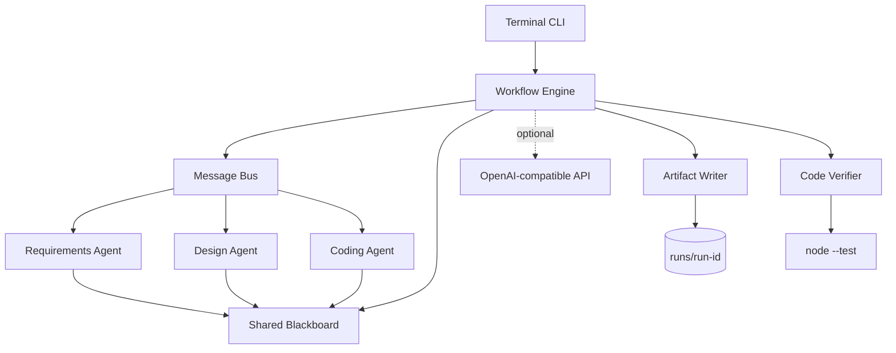
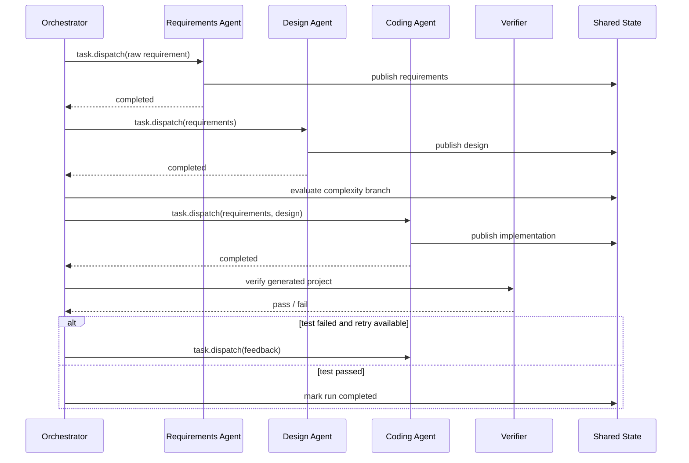

# MiniSE Workflow 详细设计

## 1. 目标与范围

本项目实现一个 2 周规模的 Mini SE 工作流 MVP，重点处理：

- 三个职责明确的 Agent 如何完成软件交付链。
- Agent 之间如何传递任务、结果和错误摘要。
- 编排器如何保存共享状态并保证节点输入正确。
- 工作流如何支持分支、循环、失败处理和追踪。
- 生成代码如何被真实执行和验证。

当前范围不包括 Web 界面、真实数据库、生产级鉴权和分布式调度。

## 2. 总体架构



系统采用单进程模块化架构。它没有外部依赖，便于在任意评审环境直接运行，同时保留
替换 Agent、存储和验证器所需的边界。

## 3. 核心模块

### WorkflowEngine

读取声明式流程定义并按节点类型执行。当前支持：

- `agent`：调用 Agent 并发布制品。
- `condition`：根据共享状态选择下一节点。
- `write`：写入当前制品。
- `verify`：执行质量门禁。
- `failure`：终止失败流程。

引擎设置最大执行步数，防止错误循环导致无限运行。

### MessageBus

消息总线基于 Node.js `EventEmitter`。引擎向 Agent 派发任务，Agent 回报任务接受与
完成，制品发布到 `blackboard`。消息同时写入共享状态并由 CLI 实时输出。

消息不携带生成代码正文。任务传递上游结构化制品，结果通过共享黑板交接，避免消息
体积随代码增长。

### WorkflowState

共享状态是单次运行的事实来源：

```text
status/currentNode/timestamps
blackboard.requirements
blackboard.design
blackboard.implementation
blackboard.verification
nodes[].status
messages[]
events[]
metrics
error
```

状态对象同时作为事件源，CLI 可以订阅事件和消息，实时打印执行轨迹。

### Optional LLM API

`LLM_API_KEY` 存在时，需求和设计 Agent 可以通过 OpenAI 兼容的
`/chat/completions` 接口获取结构化 JSON。API 地址、模型和超时分别由
`LLM_BASE_URL`、`LLM_MODEL` 和 `LLM_TIMEOUT_MS` 配置。

密钥只由 `loadLlmConfig()` 从 `process.env` 读取。配置对象不暴露可序列化的密钥
字段，消息、制品、事件和 `state.json` 均不包含密钥。请求失败时会记录不包含密钥的
错误摘要，并自动回退到本地 Agent 规则。

### Agents

三个 Agent 使用统一契约：

```js
async handle(task) {
  return artifact;
}
```

#### Requirements Agent

- 未配置 API 时，用本地规则识别实体、功能、验收标准和复杂度。
- 配置 API 时，从大模型获取结构化需求分析并校验字段类型。
- 输出可被设计 Agent 直接消费的结构化制品。

#### Design Agent

- 未配置 API 时，根据本地规则选择精简或扩展架构。
- 配置 API 时，从大模型获取模块、接口和设计决策，再校验输出结构。
- 输出模块、API、数据模型、技术决策、风险和任务拆分。
- 约束编码 Agent 的生成结果。

#### Coding Agent

- 根据实体和字段生成 CRUD 服务、HTTP 路由、测试和 README。
- 使用 Node.js 内置模块，生成项目无第三方依赖。
- 接收验证失败摘要，并记录本次重试所处理的反馈。

## 4. 执行时序



## 5. 分支与循环

需求 Agent 生成 1 到 5 的复杂度。复杂度小于 4 时进入 `code-lean`，大于等于 4 时
进入 `code-extended`。未选择的节点标记为 `skipped`。

验证循环步骤：

1. 编码 Agent 发布文件。
2. 写入器把文件放到 `generated/`。
3. 验证器检查文件完整性并执行 `node --test`。
4. 验证失败且尝试次数小于 2 时，把失败摘要交给编码 Agent 并重试。
5. 超过最大次数后进入 `failed` 节点并保存完整错误状态。

循环由流程节点表达，而不是隐藏在业务代码的 `while` 中，便于后续增加节点类型或
接入可视化编辑器。

## 6. 错误处理

| 错误类型 | 处理 |
|---|---|
| 空需求 | 引擎拒绝执行并记录错误 |
| Agent 异常 | 捕获后标记失败并持久化状态 |
| 生成文件缺失 | 验证器返回失败，触发重试 |
| 生成测试失败 | 回传测试摘要并重试 |
| 验证超时 | 终止子进程，按失败处理 |
| 不安全文件路径 | 拒绝目录穿越 |

## 7. 可观测性

每次运行使用独立目录。节点、消息和事件均带时间戳，事件还带递增序号。CLI 输出包括：

- 节点开始和完成事件。
- 条件分支选择。
- Agent 任务消息路由。
- 验证结果。
- 消息数、尝试数、重试数和运行目录。

## 8. 可扩展性

### 新增 Agent

实现 `BaseAgent` 并注册到 `agentFactories`。引擎不需要了解 Agent 内部逻辑。

### 新增大模型

可以创建 `LLMRequirementsAgent` 或 `LLMCodingAgent`，在 `handle(task)` 中调用模型。
建议保留现有结构化输出契约，并对模型输出做 JSON 校验和失败重试。

### 替换持久化

编码 Agent 将仓储封装在生成服务的 `src/service.js` 内。扩展模式已经预留 Repository
Boundary，可以替换为 SQLite、PostgreSQL 或远程服务。

### 增加并行节点

当前节点顺序执行，但 Agent 是最小执行单元。后续可增加 `parallel` 节点类型，用
`Promise.allSettled` 执行多个 Agent，再通过共享黑板汇总。

## 9. 安全与质量

- 生产路径使用固定根目录和 `path.relative` 校验，阻止目录穿越。
- 自动验证子进程不经过 shell，避免命令注入。
- 生成服务独立于工作流运行，便于验证。
- 测试覆盖 Agent 输出、完整工作流、持久化和条件分支。

## 10. 设计取舍

默认使用确定性本地 Agent，保证评审环境在没有 API Key 和网络时仍可运行。需求与设计
Agent 支持可选 LLM API，但编码结果仍由本地模板生成并通过自动测试，避免模型输出
不完整时破坏完整流程。

