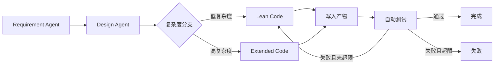

# MiniSE Workflow MVP

一个终端即可运行的三 Agent 软件工程工作流。输入自然语言需求后，系统按
`需求分析 -> 方案设计 -> 代码实现 -> 自动测试` 执行，并生成需求文档、设计文档、
可运行代码、测试报告和完整状态日志。

本项目对应作业方向 **Mini SE 流程：需求 -> 设计 -> 代码**，实现了顺序控制、
条件分支、失败重试、消息传递和共享状态。

## 运行环境

- Node.js 20 或更高版本
- 不需要安装第三方依赖
- 不需要网络或 API Key

## 快速开始

在项目根目录执行：

```bash
npm start
```

运行自定义需求：

```bash
npm start -- "实现一个任务清单，支持新增、查询、修改和删除任务"
```

运行完整测试：

```bash
npm test
```

默认需求会生成一个零依赖的图书 CRUD REST 服务，并真实执行生成项目的
`node --test`。

## 为什么没有 API 也能运行

本项目把 Agent 定义为具有独立职责、输入、输出和工具能力的程序模块。未配置 API 时，
需求分析、设计决策和代码生成由本地规则与模板完成，所以不需要网络和 API Key。

需要接入大模型时，可以配置任意 OpenAI 兼容 API。配置只从环境变量读取，不会生成
`.env` 文件，也不会写入源码、日志或 `state.json`。

### 配置 API

PowerShell 当前终端会话：

```powershell
$env:LLM_API_KEY="你的API密钥"
$env:LLM_BASE_URL="https://api.openai.com/v1"
$env:LLM_MODEL="gpt-4.1-mini"
npm start
```

使用其他 OpenAI 兼容服务时，只需替换地址和模型，例如：

```powershell
$env:LLM_BASE_URL="https://api.deepseek.com/v1"
$env:LLM_MODEL="deepseek-chat"
```

检查配置状态：

```powershell
npm run config
```

输出只显示是否配置密钥、模型和地址，不会显示密钥内容。

配置 API 后，需求 Agent 和设计 Agent 会调用大模型；编码 Agent 仍使用可测试的本地
模板生成代码，避免模型返回不完整代码导致项目无法运行。API 调用失败时会自动回退到
本地规则，流程不会中断。

## 终端输出

CLI 会实时显示以下信息：

- `EVENT`：节点开始、完成、条件分支和最终结果。
- `MSG`：编排器与 Agent 之间的任务和结果消息。
- `Run ID`：本次运行唯一标识。
- `Messages`、`Attempts`、`Retries`：协作和重试指标。
- `Run directory`：需求、设计、代码与状态的保存位置。

一次成功运行会产生：

```text
runs/<run-id>/
├── requirements.md
├── design.md
├── verification.md
├── state.json
└── generated/
    ├── package.json
    ├── README.md
    ├── src/
    │   ├── service.js
    │   └── server.js
    └── test/
        └── service.test.js
```

生成项目可以单独运行：

```bash
cd runs/<run-id>/generated
npm start
```

## 项目结构

```text
.
├── src/
│   ├── agents/                # 需求、设计、编码三个独立 Agent
│   ├── core/                  # 消息总线、共享状态、工作流引擎
│   ├── services/              # 产物写入与自动测试
│   ├── workflow/              # Mini SE 声明式流程定义
│   └── cli.js                 # 终端入口
├── test/                      # Agent 和工作流测试
├── DESIGN.md                  # 详细设计文档
├── DEFENSE_GUIDE.md           # 3 分钟答辩提纲与常见问题
└── VIDEO_SCRIPT.md            # 1 分钟终端演示脚本
```

## 工作流



- 复杂度小于 4：进入精简实现分支。
- 复杂度大于等于 4：进入扩展实现分支。
- 生成测试失败：把失败摘要反馈给编码 Agent，最多尝试两次。
- 超过重试次数：运行标记为失败，完整状态仍会保存。

## Agent 设计

| Agent | 输入 | 输出 | 职责 |
|---|---|---|---|
| Requirements Agent | 自然语言需求 | 实体、功能、用户故事、验收标准、复杂度 | 本地规则或可选 LLM API |
| Design Agent | 需求制品 | 架构、模块、API、设计决策、风险 | 本地规则或可选 LLM API |
| Coding Agent | 需求、设计、重试反馈 | 完整文件集合 | 生成服务、测试和项目文档 |

三个 Agent 不直接修改彼此的状态。编排器通过消息总线派发任务，Agent 完成后把制品
发布到共享黑板，下游节点从黑板读取输入。API Key 不进入消息、制品或共享状态。

## 消息协议

每条消息包含 `id`、`correlationId`、`from`、`to`、`kind`、`timestamp` 和
`payload`。

| 消息类型 | 方向 | 用途 |
|---|---|---|
| `task.dispatch` | Orchestrator -> Agent | 派发任务与上游制品 |
| `agent.accepted` | Agent -> Orchestrator | 表示任务已被接收 |
| `agent.completed` | Agent -> Orchestrator | 返回执行摘要 |
| `artifact.published` | Agent -> Blackboard | 发布结构化产物 |

## 状态管理

`WorkflowState` 保存运行状态、当前节点、共享制品、节点状态、消息、事件、尝试次数、
重试次数和最终错误。每次运行结束后，完整快照写入 `runs/<run-id>/state.json`。

节点状态包括：

- `idle`
- `running`
- `completed`
- `failed`
- `skipped`

## 扩展方式

1. 新建继承 `BaseAgent` 的 Agent，实现 `handle(task)`。
2. 在 `src/workflow/mini-se.workflow.js` 的 `agentFactories` 中注册 Agent。
3. 在流程 `nodes` 中增加节点，指定 `agent`、`artifact` 和 `next`。
4. 使用 `kind: "condition"` 实现条件分支。
5. Agent 消息和节点状态会自动进入现有日志，无需修改引擎。

需求与设计 Agent 已经支持可选 LLM 调用。继续替换其他 Agent 时，只要保持
`handle(task)` 输入输出契约，工作流、状态管理和自动验证都不需要变化。

## 作业要求对应

| 评分维度 | 实现 |
|---|---|
| 流程完整性 40% | 需求、设计、代码、写入、测试、完成形成闭环 |
| Agent 协作 30% | 三个独立 Agent、消息总线、共享黑板、结构化交接 |
| 可扩展性 20% | Agent 注册表、声明式节点、条件分支、重试机制 |
| 文档 10% | README、DESIGN、流程图、运行方式和设计决策 |

## 已知边界

- 未配置 API 时，Agent 使用本地规则，保证离线可重复演示。
- API Key 只保存在当前进程环境变量中，不写入项目文件。
- 生成服务使用内存存储，适合 MVP，不应直接用于生产。
- 当前为单机单进程执行，没有实现分布式 Agent 调度。
- 运行目录默认被 `.gitignore` 忽略，提交时可按需要保留一次示例运行。

